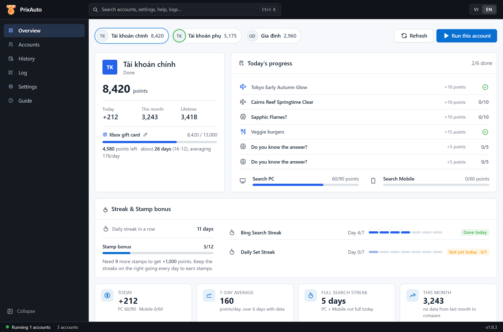
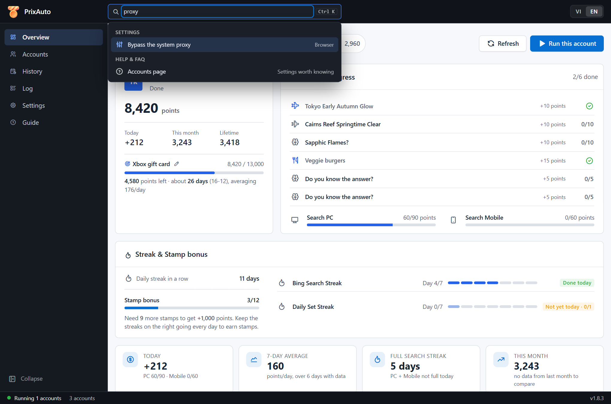
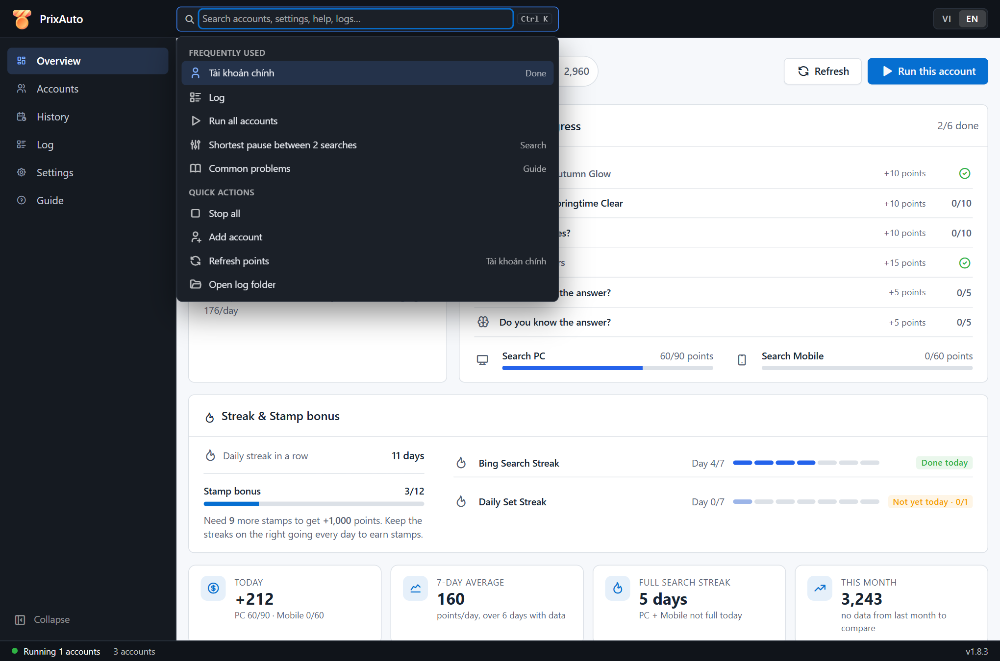
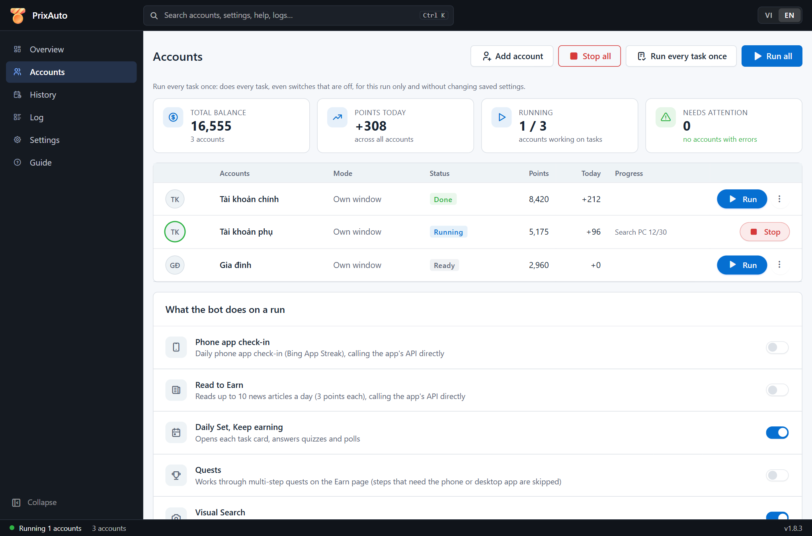
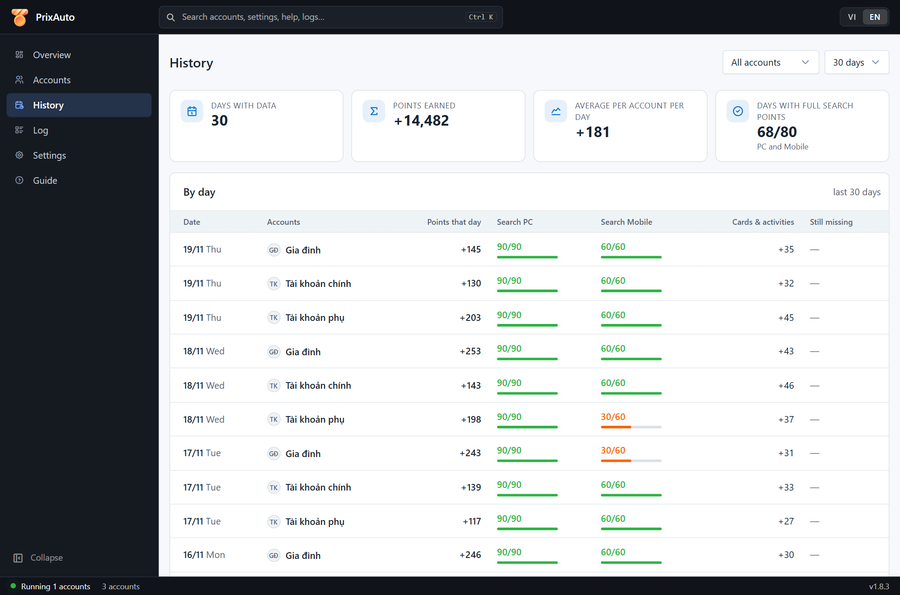
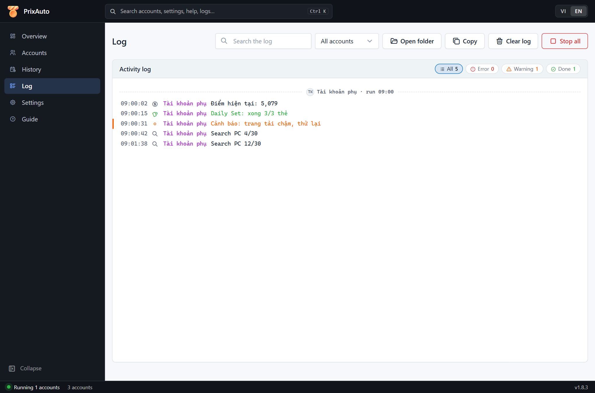
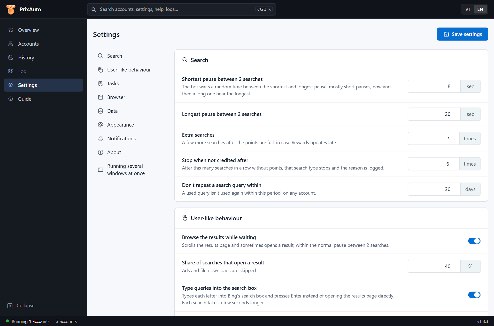
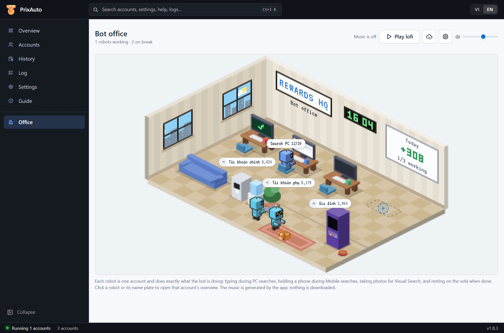
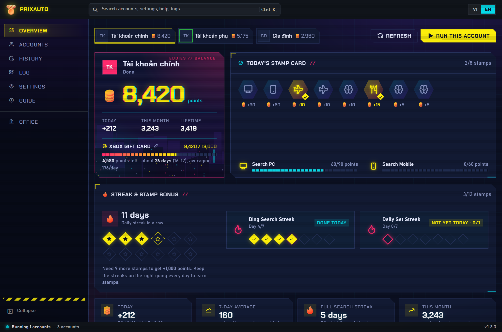
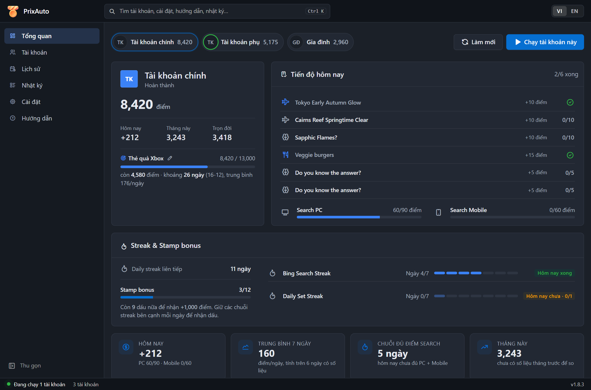

<div align="center">


# PrixAuto

**A bot that farms Microsoft Rewards every day. Many accounts. One click.**

[](https://github.com/NT101-lc/reward-automation/releases/latest)
[](https://github.com/NT101-lc/reward-automation/releases)
[](https://github.com/NT101-lc/reward-automation/stargazers)
[](https://github.com/NT101-lc/reward-automation/commits)
[](LICENSE)
<br>


[**⬇️ Download**](https://github.com/NT101-lc/reward-automation/releases/latest) ·
[What it does](#-what-it-does) ·
[1-minute setup](#-1-minute-setup) ·
[Quick FAQ](#-quick-faq) ·
[Tiếng Việt](README.md) ·
[Website](https://nt101-lc.github.io/reward-automation/)

<br>



</div>

> [!WARNING]
> Microsoft **bans** bots on Rewards. Your account can get **banned and lose its points**. Use at your own risk, never on an account you can't lose.

## ✨ What it does

| | |
|---|---|
| 🤖 **Does it all** | Daily Set, Quests, PC + Mobile searches, Visual Search, Read to Earn, app check-in |
| 👯 **Many accounts at once** | Each account gets its own Edge window, run in parallel |
| 🧠 **Searches like a human** | Types letter by letter, random pauses, no repeated queries across accounts |
| 📊 **Clean dashboard** | Points, streaks, history, reward goals |
| 🔔 **Pings your phone** | Telegram / Discord message when a run ends |
| 🔒 **Nothing leaves your PC** | Data stays local, passwords encrypted by Windows |

## 🆕 New

**Docker Desktop-style look**: search bar on top, menu on the left, status bar at the bottom, navy dark theme.

**🔍 Find anything with `Ctrl K`**: accounts, settings, help, FAQ, logs. Part of a word is enough.



**⚡ Empty search = suggestions**: what you open most + quick actions (Run all, Add account…). Learns as you use it.



**⏰ Daily schedule inside the app**: pick a time, done. No more digging in Task Scheduler.

**🔄 No more pressing Refresh**: points update when the app opens, and again 3 minutes after a run.

**Tidier pages**: Accounts has 4 summary tiles (total points, today, running, needs attention). Settings has a section menu on the left.

## 📸 Screenshots

<table>
  <tr>
    <td width="50%"><p align="center"><b>Accounts</b></p></td>
    <td width="50%"><p align="center"><b>History</b></p></td>
  </tr>
  <tr>
    <td><p align="center"><b>Log</b></p></td>
    <td><p align="center"><b>Settings</b></p></td>
  </tr>
  <tr>
    <td><p align="center"><b>Fun mode: robot office</b></p></td>
    <td><p align="center"><b>Fun mode: Cyberpunk</b></p></td>
  </tr>
</table>

<details>
<summary>🌙 Dark theme</summary>
<br>

</details>

## 🚀 1-minute setup

You need: Windows 10/11 64-bit, Edge (already installed), a [Microsoft Rewards](https://rewards.bing.com) account. **No Python.**

1. **Download** the `-win64.zip` file from the [latest release](https://github.com/NT101-lc/reward-automation/releases/latest) (not *Source code*).
2. **Extract** to `C:\PrixAuto`. Don't run it inside the zip, and don't put it in Program Files or OneDrive.
3. **Open** `PrixAuto.exe`. Blue Windows screen? Click **More info → Run anyway** (the app isn't code-signed yet, it's not a virus).
4. **Log in**: Accounts page → **⋮ → Log in** → sign in on the Rewards tab, check the bing.com tab shows the same account → close the window.
5. **Run**: click **⋮ → Check** to be sure, then **Run all**. About 20–40 minutes per account.

> [!TIP]
> Run it every day by itself: **Settings → Run automatically every day** → pick a time → **Save schedule**. Close the app
> before that time. Made a Task Scheduler task by hand the old way? Delete it so it doesn't run twice.

**Updates**: the app tells you when a new version is out. Click **Update now**, done. Accounts and settings stay.

## ❓ Quick FAQ

<details><summary><b>App opens blank / closes right away</b></summary>

WebView2 is missing. Install the *Evergreen Bootstrapper* from [Microsoft's page](https://developer.microsoft.com/microsoft-edge/webview2/). Still broken? Check `data\crash.log`.
</details>

<details><summary><b>Double-clicking PrixAuto.exe does nothing</b></summary>

It's already open (check the taskbar) or running in the background from Task Scheduler.
</details>

<details><summary><b>Mobile searches give 0 points</b></summary>

Run **Check**. The bing.com tab must use the same account as Rewards.
</details>

<details><summary><b>Edge – Minutes stuck at 0/30</b></summary>

Microsoft is hit-or-miss here. Usually takes 3–4 Browse runs a day; turn off "Stop when minutes aren't counted".
</details>

<details><summary><b>Visual Search says "Unable to process this search"</b></summary>

Bing blocks it after too many tries in a day. Try tomorrow.
</details>

<details><summary><b>Get Telegram / Discord notifications</b></summary>

**Settings → Notifications**. Telegram: get a token from [@BotFather](https://t.me/BotFather) + your Chat ID. Discord: create a Webhook in the channel. Click **Send test**.
</details>

<details><summary><b>How do I report a bug?</b></summary>

Open an [issue](https://github.com/NT101-lc/reward-automation/issues) with `data\logs\<date>.log` attached. **Never share the whole `data\` folder** (it has your login cookies).
</details>

## 🔒 Privacy

- No usage stats sent. Only reads GitHub to check for updates (can be turned off).
- `data\` holds your login cookies and is locked to your Windows account. Don't give it to anyone.
- Passwords (if auto login is on) and Telegram/Discord tokens: encrypted by Windows, never written to logs.

## 🛠️ For devs

<details>
<summary><b>Run from source</b></summary>

```bash
git clone https://github.com/NT101-lc/reward-automation.git
cd reward-automation
pip install -r requirements.txt
python -m rewards_bot
```

| Command | What it does |
|---|---|
| `python -m rewards_bot` | Open the app |
| `--run-all --headless` | Run every account, no window |
| `--check` | Check only, no searches |
| `--checkin` | Phone app check-in only |
| `--now` | Start right away, no random delay |

Linux: needs Edge/Chrome/Chromium, run `./scripts/run.sh`. The UI needs GTK (`python3-gi gir1.2-webkit2-4.1`) or Qt.
</details>

<details>
<summary><b>Tests and releases</b></summary>

```bash
pip install -r requirements-dev.txt
python -m pytest -q tests
```

Release: bump `__version__` in `rewards_bot/__init__.py`, push a `v<version>` tag. GitHub Actions builds `PrixAuto.exe` and publishes the zip with a `.sha256`.
</details>

<details>
<summary><b>How the bot works</b></summary>

- Opens Edge like a normal browser and drives it through a debug port on `127.0.0.1` only (idea from [AutoRewarder](https://github.com/safarsin/AutoRewarder), MIT).
- Compares points on bing.com with Rewards before searching: **wrong account, no searches**.
- Stops a search type when several searches in a row earn nothing.
- English queries from 22 topics (~2,600 long queries + 10,000 popular keywords), never shared between accounts.
</details>

Like it? Drop the repo a ⭐. Found a bug? Open an [issue](https://github.com/NT101-lc/reward-automation/issues).

---

<sub>MIT. Bundled libraries keep their own licenses (see `rewards_bot/ui/web/vendor/`). "Microsoft", "Bing", "Edge" and "Microsoft Rewards" are trademarks of Microsoft; this project is not affiliated with Microsoft.</sub>
