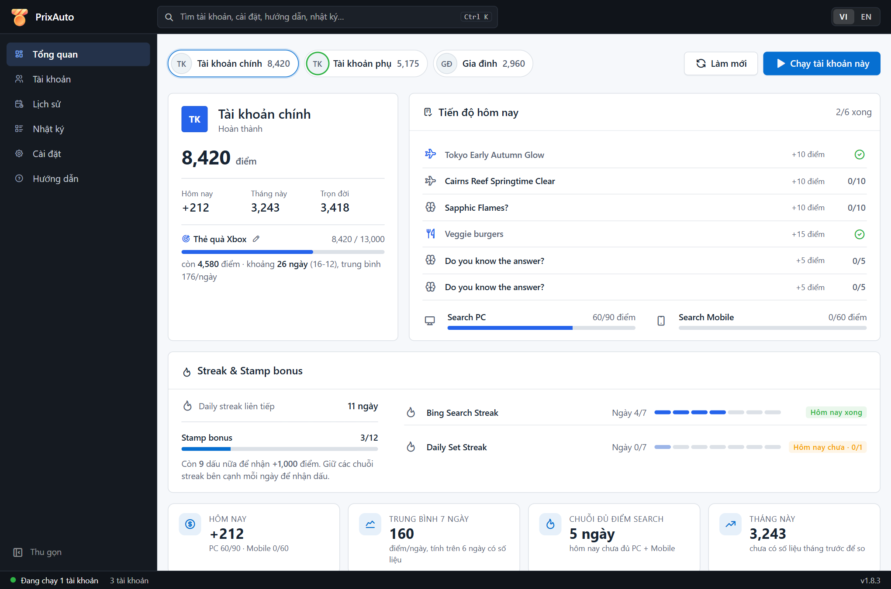
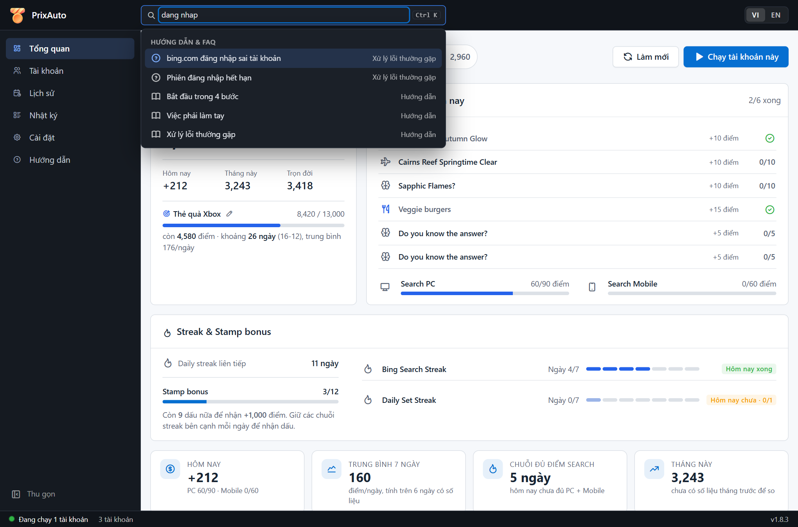
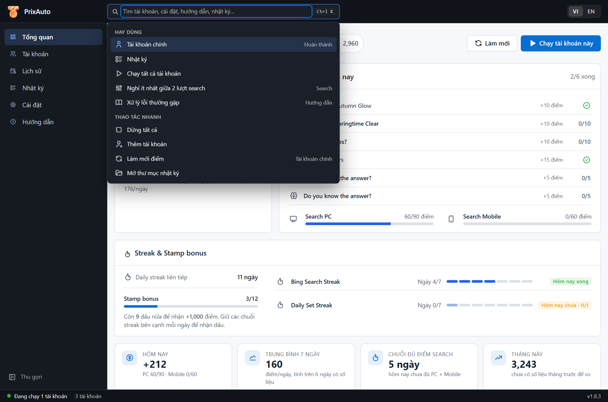
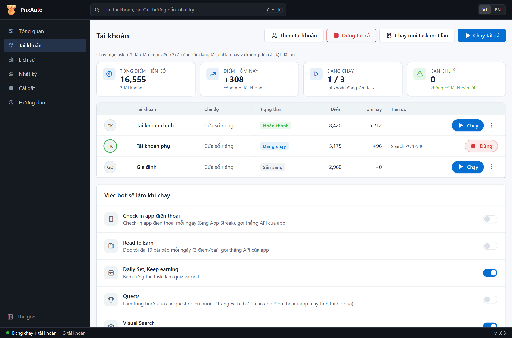
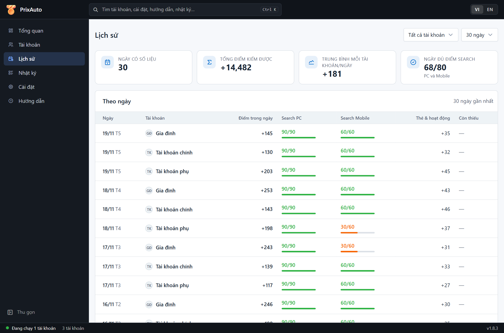
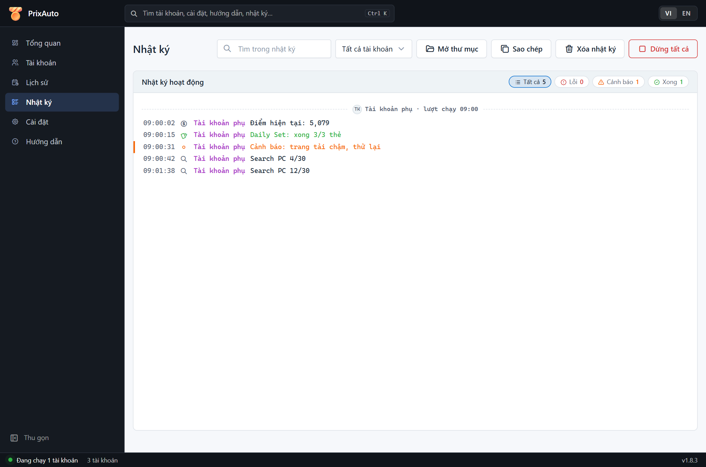
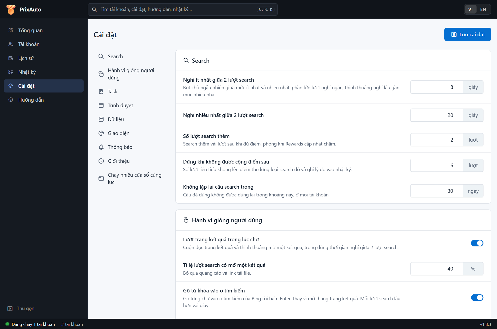
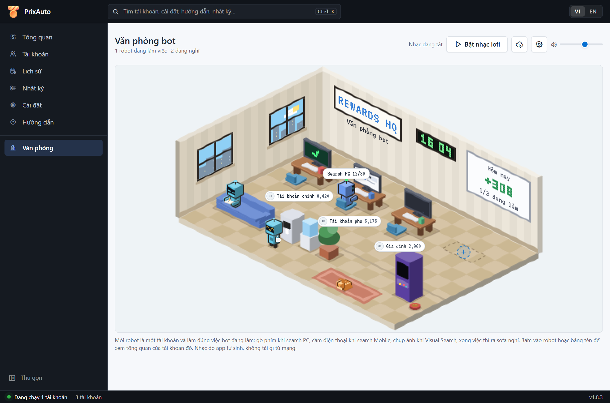
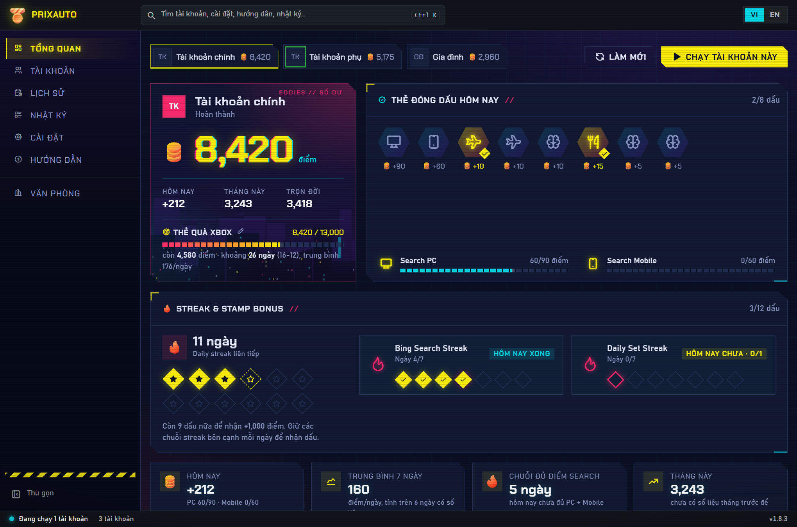
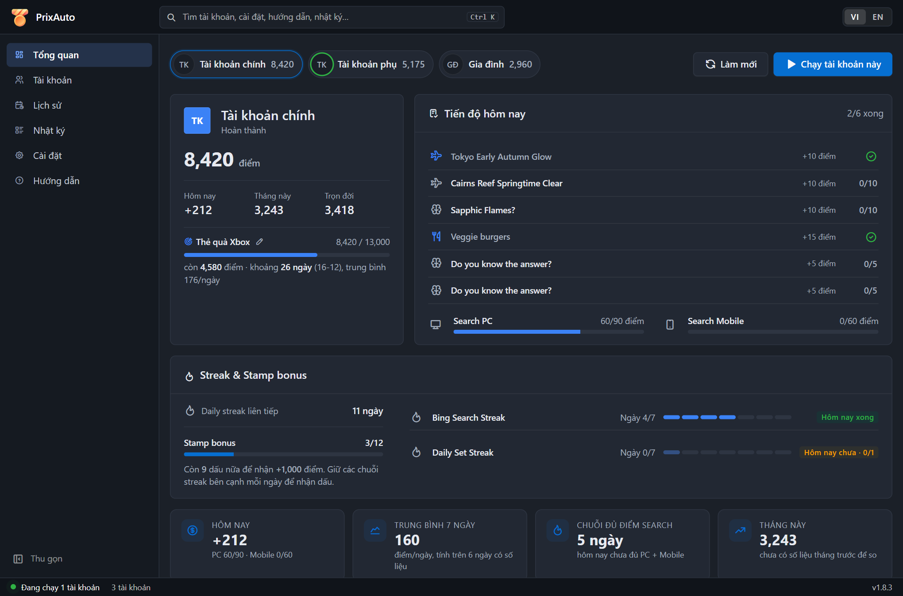

<div align="center">


# PrixAuto

**Bot cày Microsoft Rewards mỗi ngày. Nhiều tài khoản. Bấm một nút là xong.**

[](https://github.com/NT101-lc/reward-automation/releases/latest)
[](https://github.com/NT101-lc/reward-automation/releases)
[](https://github.com/NT101-lc/reward-automation/stargazers)
[](https://github.com/NT101-lc/reward-automation/commits)
[](LICENSE)
<br>


[**⬇️ Tải về**](https://github.com/NT101-lc/reward-automation/releases/latest) ·
[Có gì](#-có-gì) ·
[Cài trong 1 phút](#-cài-trong-1-phút) ·
[Hỏi nhanh](#-hỏi-nhanh) ·
[English](README.en.md) ·
[Website](https://nt101-lc.github.io/reward-automation/vi/)

<br>



</div>

> [!WARNING]
> Microsoft **cấm** bot kiếm điểm Rewards. Có thể bị **khóa tài khoản, mất điểm**. Dùng là tự chịu, đừng dùng acc bạn sợ mất.

## ✨ Có gì

| | |
|---|---|
| 🤖 **Tự làm hết** | Daily Set, Quests, Search PC + Mobile, Visual Search, Read to Earn, check-in app |
| 👯 **Nhiều acc cùng lúc** | Mỗi acc một cửa sổ Edge riêng, chạy song song |
| 🧠 **Search như người** | Gõ từng chữ, nghỉ ngẫu nhiên, không trùng câu giữa các acc |
| 📊 **Dashboard xịn** | Điểm, streak, lịch sử, mục tiêu đổi quà |
| 🔔 **Báo về điện thoại** | Chạy xong nhắn Telegram / Discord |
| 🔒 **Không gửi gì đi đâu** | Dữ liệu ở trên máy bạn, mật khẩu được Windows mã hóa |

## 🆕 Mới

**Giao diện kiểu Docker Desktop**: thanh tìm kiếm ở trên, menu bên trái, thanh trạng thái ở dưới, theme tối xanh than.

**🔍 Tìm mọi thứ bằng `Ctrl K`**: tài khoản, cài đặt, hướng dẫn, FAQ, nhật ký. Gõ không dấu cũng được.



**⚡ Ô tìm trống = gợi ý**: hiện mấy thứ bạn hay mở + nút làm nhanh (Chạy tất cả, Thêm tài khoản…). Càng dùng càng đúng ý.



**⏰ Hẹn giờ chạy mỗi ngày ngay trong app**: chọn giờ là xong, khỏi mò Task Scheduler.

**🔄 Hết phải bấm Làm mới**: mở app là điểm tự cập nhật, chạy xong 3 phút cũng tự cập nhật.

**Gọn hơn**: trang Tài khoản có 4 ô tóm tắt (tổng điểm, hôm nay, đang chạy, acc lỗi). Trang Cài đặt có menu mục bên trái.

## 📸 Ảnh

<table>
  <tr>
    <td width="50%"><p align="center"><b>Tài khoản</b></p></td>
    <td width="50%"><p align="center"><b>Lịch sử</b></p></td>
  </tr>
  <tr>
    <td><p align="center"><b>Nhật ký</b></p></td>
    <td><p align="center"><b>Cài đặt</b></p></td>
  </tr>
  <tr>
    <td><p align="center"><b>Chế độ vui: văn phòng robot</b></p></td>
    <td><p align="center"><b>Chế độ vui: Cyberpunk</b></p></td>
  </tr>
</table>

<details>
<summary>🌙 Theme tối</summary>
<br>

</details>

## 🚀 Cài trong 1 phút

Cần: Windows 10/11 64-bit, Edge (có sẵn), một acc [Microsoft Rewards](https://rewards.bing.com). **Không cần Python.**

1. **Tải** file `-win64.zip` ở [bản mới nhất](https://github.com/NT101-lc/reward-automation/releases/latest) (không phải *Source code*).
2. **Giải nén** ra `C:\PrixAuto`. Đừng chạy thẳng trong zip, đừng để trong Program Files hay OneDrive.
3. **Mở** `PrixAuto.exe`. Windows hiện màn xanh thì bấm **More info → Run anyway** (app chưa mua chữ ký số, không phải virus).
4. **Đăng nhập**: trang Tài khoản → **⋮ → Đăng nhập** → đăng nhập ở tab Rewards, kiểm tra tab bing.com cùng acc → đóng cửa sổ.
5. **Chạy**: bấm **⋮ → Kiểm tra** cho chắc, rồi **Chạy tất cả**. Mỗi acc mất khoảng 20–40 phút.

> [!TIP]
> Muốn tự chạy mỗi ngày: **Cài đặt → Chạy tự động mỗi ngày** → chọn giờ → **Lưu lịch chạy**. Nhớ đóng app trước giờ đó.
> Đã tự tạo lịch bằng Task Scheduler theo cách cũ thì xóa lịch cũ đi cho khỏi chạy 2 lần.

**Cập nhật**: có bản mới thì app tự báo, bấm **Cập nhật ngay** là xong. Tài khoản và cài đặt giữ nguyên.

## ❓ Hỏi nhanh

<details><summary><b>Mở app trắng trơn / tắt ngay</b></summary>

Thiếu WebView2. Cài *Evergreen Bootstrapper* ở [trang của Microsoft](https://developer.microsoft.com/microsoft-edge/webview2/). Vẫn lỗi thì xem `data\crash.log`.
</details>

<details><summary><b>Bấm PrixAuto.exe không thấy gì</b></summary>

App đang mở sẵn (xem taskbar) hoặc đang chạy ngầm từ Task Scheduler.
</details>

<details><summary><b>Search Mobile được 0 điểm</b></summary>

Chạy **Kiểm tra**. Tab bing.com phải cùng acc với Rewards.
</details>

<details><summary><b>Edge – Minutes mãi 0/30</b></summary>

Hên xui do Microsoft. Thường phải chạy Browse 3–4 lần/ngày, tắt "Tự dừng".
</details>

<details><summary><b>Visual Search báo "Unable to process this search"</b></summary>

Bing chặn khi thử nhiều lần trong ngày. Đợi mai.
</details>

<details><summary><b>Nhận thông báo Telegram / Discord</b></summary>

**Cài đặt → Thông báo**. Telegram: lấy token từ [@BotFather](https://t.me/BotFather) + Chat ID. Discord: tạo Webhook trong kênh. Bấm **Gửi thử**.
</details>

<details><summary><b>Báo lỗi thế nào?</b></summary>

Mở [issue](https://github.com/NT101-lc/reward-automation/issues), gửi kèm `data\logs\<ngày>.log`. **Đừng gửi cả thư mục `data\`** (có cookie đăng nhập).
</details>

## 🔒 Riêng tư

- Không gửi số liệu sử dụng. Chỉ đọc GitHub để kiểm tra bản mới (tắt được).
- `data\` chứa cookie đăng nhập, được khóa quyền chỉ cho tài khoản Windows của bạn. Đừng đưa cho ai.
- Mật khẩu (nếu bật tự đăng nhập), token Telegram/Discord: Windows mã hóa, không ghi ra nhật ký.

## 🛠️ Cho dev

<details>
<summary><b>Chạy từ mã nguồn</b></summary>

```bash
git clone https://github.com/NT101-lc/reward-automation.git
cd reward-automation
pip install -r requirements.txt
python -m rewards_bot
```

| Lệnh | Làm gì |
|---|---|
| `python -m rewards_bot` | Mở app |
| `--run-all --headless` | Chạy mọi acc, không mở cửa sổ |
| `--check` | Kiểm tra, không search |
| `--checkin` | Chỉ check-in app điện thoại |
| `--now` | Chạy ngay, không chờ ngẫu nhiên |

Linux: cần Edge/Chrome/Chromium, chạy `./scripts/run.sh`. Giao diện cần GTK (`python3-gi gir1.2-webkit2-4.1`) hoặc Qt.
</details>

<details>
<summary><b>Test và phát hành</b></summary>

```bash
pip install -r requirements-dev.txt
python -m pytest -q tests
```

Phát hành: tăng `__version__` trong `rewards_bot/__init__.py`, đẩy tag `v<phiên bản>`. GitHub Actions build `PrixAuto.exe` và đăng zip kèm `.sha256`.
</details>

<details>
<summary><b>Bot hoạt động thế nào</b></summary>

- Mở Edge như trình duyệt thường, điều khiển qua cổng debug chỉ trên `127.0.0.1` (ý tưởng từ [AutoRewarder](https://github.com/safarsin/AutoRewarder), MIT).
- Đối chiếu điểm bing.com với Rewards trước khi search: **sai acc thì không search**.
- Nhiều lượt liền không được cộng điểm thì tự dừng loại search đó.
- Câu search tiếng Anh từ 22 lĩnh vực (~2.600 câu dài + 10.000 từ khóa phổ biến), không trùng giữa các acc.
</details>

Thích thì cho repo một ⭐ nhé. Gặp lỗi cứ mở [issue](https://github.com/NT101-lc/reward-automation/issues).

---

<sub>MIT. Thư viện đi kèm giữ giấy phép riêng (xem `rewards_bot/ui/web/vendor/`). "Microsoft", "Bing", "Edge", "Microsoft Rewards" là thương hiệu của Microsoft; dự án này không liên quan đến Microsoft.</sub>
